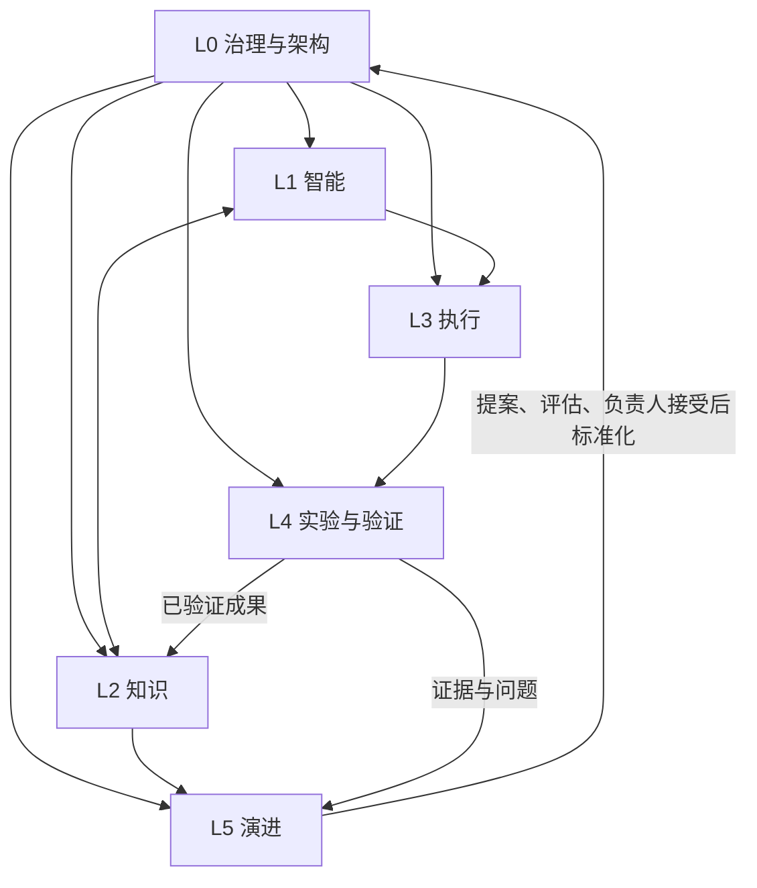

# PAIOS Architecture V1.1

文档版本：1.0.0 | 架构目标：V1.1 | 状态：Accepted（分层与职责）

更新时间：2026-11-11（Asia/Shanghai） | 具体接口与运行效果：Proposed / 待验证

## 六层职责

| 层 | 职责 | 输入 → 输出 | 当前承载或候选工具 |
| --- | --- | --- | --- |
| L0 · Governance & Architecture | 定义目标、原则、架构、工作流、评估与变更规则 | 个人目标、L5 证据 → 规范、ADR、版本决策 | `00_System/` 中的 Markdown 与 Git 历史 |
| L1 · Intelligence | 理解、推理、研究、辅导、生成方案 | 任务、规范、授权知识 → 建议、草稿、假设 | ChatGPT / DeepSeek 等可替换模型与交互工具 |
| L2 · Knowledge | 保存来源、知识、成果与关联 | 经整理的成果 → 可检索、可复用资产 | Markdown；当前使用 Obsidian 浏览和编辑 |
| L3 · Execution | 将已授权方案落实为文件、代码或操作 | 明确任务与约束 → 产物、变更说明、运行记录 | DeepSeek Harness（用户报告）、Python、Git、VS Code |
| L4 · Experiment & Validation | 检验正确性及改进是否有效 | 产物、预先定义的标准 → 证据、失败项、评估结果 | 实际任务、测试、人工检查；按需要选择工具 |
| L5 · Evolution | 观察、诊断、复盘并提出改进 | 运行反馈、L4 证据 → 改进提案、复审与标准化建议 | `06_Reviews/`、系统实验记录、Evolution 流程 |

层是逻辑职责，不是六个必须安装的程序。Git 支持 L0 的规范历史，也支持 L3 的代码执行；系统实验记录承载 L4 证据，不能因位于 `00_System/` 就自动成为正式规范。

## 协作与反馈

文字路径：L0 约束所有层；L1 使用 L2 的知识形成方案，L3 执行，L4 验证，成果回到 L2；L5 汇总运行经验，经 Observe → Diagnose → Design → Implement → Evaluate → Standardize 更新 L0。任务可以从学习或手工研究开始，不强制每次调用执行工具。

## 实际目录的职责映射

| 实际目录 | 用途与边界 |
| --- | --- |
| `00_System/` | 系统规范、ADR、工作流和系统改进实验；是 L0 的主来源 |
| `00_Inbox/` | 尚未分类的捕获内容；整理后按授权归档 |
| `01_Research/` | 研究问题、来源、结论、研究成果 |
| `02_Learning/` | 概念理解、练习、自测与知识关联 |
| `03_Projects/` | 项目目标、技术方案、结果与代码位置说明 |
| `04_Knowledge/` | 经过整理的可复用知识；不是所有草稿的堆放处 |
| `05_AI_Workflows/` | 工具操作示例、提示词应用副本、具体任务流程实例；标准定义仍在 `00_System/Workflows/` |
| `06_Reviews/` | 每周、每月复盘及反馈证据；不直接修改正式架构 |
| `99_Assets/` | 附件与已有材料；本次保留原文件，不实施迁移 |

上述目录均在 2026-11-11 实际检查中存在。Vault 位于 `E:\Personal-AI-OS\My AI Brain`；父目录还存在 `My AI Projects` 及四个命名为 Project 01–04 的文件夹。它们的出现不能证明与 ChatGPT Projects 已建立映射，代码库边界仍待明确。

## 最小任务交接协议（Proposed）

先使用一段 Markdown，不开发新框架：

| 输入 | 输出 |
| --- | --- |
| 任务名称、目标与验收条件 | 完成/部分完成/失败，以及依据 |
| 规范版本、相关 ADR、源文件路径 | Markdown 成果路径及变更清单 |
| 允许操作的文件范围与约束 | 验证方法、实际结果、未验证项 |
| 可用工具及已知限制 | 来源、假设、失败原因与下一步 |

模型特有配置留在工具配置侧；任务目标、证据与最终成果保留为普通文件。此协议尚未经过两个模型或两个执行器的替换测试。

## 工具替换的连续性检查（Proposed）

更换模型或 Harness 时，用同一小任务检查：能否读取规范、接受相同任务描述、生成可读产物、留下验证记录、重新打开历史决策。通过前保留原流程作为退路；不得先删除旧知识或宣称兼容完成。

## 决策关联

[ADR-001](Decisions/ADR-001.md) 定义知识存储；[ADR-002](Decisions/ADR-002.md) 定义 AI 工作空间；[ADR-003](Decisions/ADR-003-Model-Agnostic-Harness.md) 定义执行抽象；[ADR-004](Decisions/ADR-004-Governance-Layer.md) 定义治理、反馈和规范权威。
